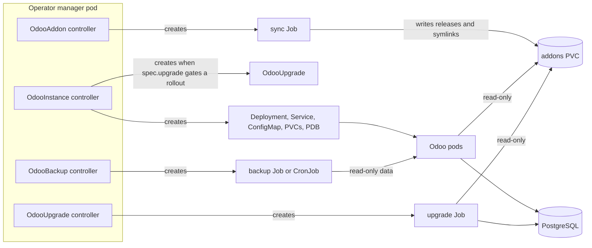
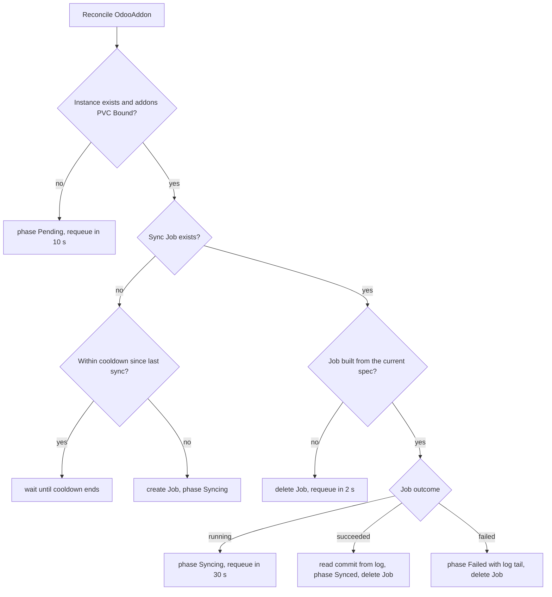
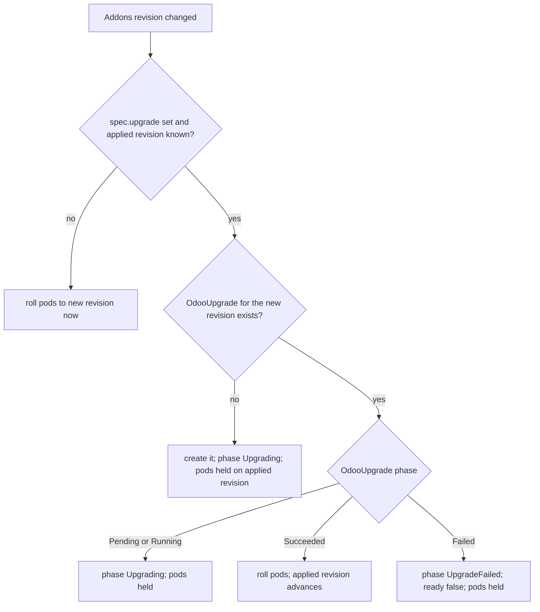

# Architecture

The operator is one Go controller-runtime manager with four controllers: OdooInstance, OdooAddon, OdooUpgrade and OdooBackup. The controllers never run Git or Odoo themselves. They create Kubernetes Jobs and Deployments, and act on what those objects report. This page explains the moving parts, the reconcile flow of each controller, the addons volume, and how pods are rolled.

## Contents

- [Components](#components)
- [Objects per OdooInstance](#objects-per-odooinstance)
- [OdooInstance reconcile](#odooinstance-reconcile)
- [OdooAddon reconcile and sync](#odooaddon-reconcile-and-sync)
- [OdooUpgrade reconcile](#odooupgrade-reconcile)
- [OdooBackup reconcile](#odoobackup-reconcile)
- [Addons volume layout](#addons-volume-layout)
- [Rollouts](#rollouts)
- [Upgrade gate](#upgrade-gate)
- [Watches, concurrency and finalizers](#watches-concurrency-and-finalizers)

## Components



| Component | Runs as | Role |
|---|---|---|
| Operator manager | Deployment `odoo-k8-operator-controller-manager` in `odoo-k8-operator-system` (default) | Runs the three controllers. Serves health probes on `:8081`. The default manifests also serve metrics on `:8443` (HTTPS). Optionally serves the OdooAddon admission webhook. |
| Odoo pods | Deployment `<instance>` | Run Odoo with the generated `odoo.conf`. |
| Sync Job | Job `<addon>-sync` | Clones or fetches one repository and publishes its modules to the addons volume. |
| Upgrade Job | Job `<upgrade>-run` | Runs `odoo -u/-i ... --stop-after-init` against one database. |
| Backup Job | Job `<backup>-run`, or CronJob `<backup>-sched` | Dumps one database with `pg_dump` and archives the filestore, to a PVC or S3. See [backups.md](backups.md). |

The manager image is built from `Dockerfile` and runs as UID 65532 on a distroless base. It contains no `git` binary. Git runs only inside sync Jobs.

## Objects per OdooInstance

Names use `<name>` for the OdooInstance name. The full table, with labels and retention rules, is in [odooinstance.md](odooinstance.md#generated-objects).

| Object | Name | Owner |
|---|---|---|
| Deployment | `<name>` | OdooInstance |
| Service (ClusterIP, 8069 and 8072) | `<name>` | OdooInstance |
| ConfigMap (`odoo.conf`) | `<name>-config` | OdooInstance |
| PVC addons (always owned) | `<name>-addons` | OdooInstance |
| PVC filestore (owned only if `retainOnDelete: false`) | `<name>-data` | OdooInstance or none |
| PodDisruptionBudget (`replicas > 1`) | `<name>` | OdooInstance |
| OdooUpgrade (gate) | `<name>-upg-<hash8>` | OdooInstance |

Each OdooAddon has its own sync Job, `<addon>-sync`, owned by the OdooAddon. Each OdooUpgrade has its own Job, `<name>-run`, owned by the OdooUpgrade.

Deleting an OdooInstance removes its owned objects through Kubernetes garbage collection. OdooAddon objects are not owned by the instance, so they stay and go to `Pending`.

## OdooInstance reconcile

On each reconcile, in order:

1. Read the OdooInstance. If it is being deleted, remove the finalizer `odoo.operator.io/instance-finalizer` and stop. The finalizer does no other work.
2. Add the finalizer if missing.
3. Create or adopt both PVCs. Set or remove the owner reference of the filestore PVC to match `retainOnDelete`.
4. Render `odoo.conf` from the spec, and create or update the ConfigMap.
5. Read the Secrets referenced by `postgres.passwordSecret` and `adminPasswordSecret`. A missing Secret is an error.
6. List the ready OdooAddons bound to this instance, and compute the addons revision.
7. Run the upgrade gate, which chooses the revision the pods run (see [Upgrade gate](#upgrade-gate)). It may create an OdooUpgrade.
8. Compute the three rollout hashes and create or update the Deployment, PDB and Service.
9. Set `status.addonPaths` from the ready addons.
10. Set `status.phase` and `status.ready` from the Deployment's ready replicas, and from the gate.

If any step returns an error, the phase becomes `Failed`, the error is logged, and the reconcile is retried with backoff.

## OdooAddon reconcile and sync

The addon reconciler is a state machine over the sync Job. It never waits for a Job to finish. Each reconcile inspects the Job once and returns. A Job's progress comes back through the watch on Jobs owned by the addon.



The diagram shows the main path. Two more cases exist: a Job with the same name that this OdooAddon does not own makes the addon `Failed` (`job name conflict`), and an invalid spec makes it `Failed` without creating a Job. The cooldown is 5 minutes after a success and 30 seconds after a failure. A commit-pinned addon that is already `Synced` at that commit is not synced again.

Inside the Job the sync script runs these steps:

1. Fetch the repository. A branch or tag is cloned with `--depth 1`. A commit SHA is fetched with `git fetch --depth 1 origin <sha>`.
2. Create the release directory `/mnt/odoo/addons/.releases/<addon>/<sha>/` and copy each module into it, unless the release already has it. The copy goes to a `.partial` directory first, which is then renamed.
3. For each module, create a symlink `.<module>.tmp` that points at the release, then `mv -T` it over `/mnt/odoo/addons/<module>`.
4. Keep the two newest release directories for the addon. Delete older ones.
5. Print the commit SHA as the last line.

The last line of the log is the only output the operator uses. Everything else goes to stderr.

## OdooUpgrade reconcile

1. Read the OdooUpgrade. Stop if it is `Succeeded` or `Failed`.
2. If it is `Running` with a Job name, monitor the Job (below).
3. Validate the spec. An invalid spec sets `Failed`.
4. Read the OdooInstance. If it is missing, set `Pending` and wait.
5. List the OdooUpgrades of the same instance. If another one is `Running`, or an older one is `Pending`, set `Pending` and wait.
6. Create the Job `<name>-run` (adopting an existing one) and set `Running`.

Monitoring the Job:

- `Succeeded`: the Job completed. Set `Succeeded`.
- `Failed`: the Job has a Failed condition, or a failed pod. Set `Failed` with the reason and the log tail.
- Job missing: after a 30-second grace period, set `Failed` (`upgrade Job ... no longer exists`).

## OdooBackup reconcile

1. Read the OdooBackup. A one-shot backup stops if it is `Succeeded` or `Failed`. A scheduled one always continues.
2. A one-shot backup that is `Running` with a Job name is monitored (below).
3. Validate the spec. An invalid spec sets `Failed`.
4. Read the OdooInstance. If it is missing, set `Pending` and wait.
5. One-shot only: list the OdooBackups of the same instance. If another is `Running`, or an older one is `Pending`, set `Pending` and wait. Scheduled backups are not queued.
6. Create the Job `<name>-run` (adopting an existing one) and set `Running`.

A scheduled backup creates or updates the CronJob `<name>-sched` when its spec hash changes, and sets `Scheduled`. The CronJob is owned by the OdooBackup. If the API server rejects it, the backup is `Failed` with reason `CronJobRejected`.

Monitoring the Job follows the same rules as OdooUpgrade. On success the result line `backup: <files>` from the pod log is stored in `status.lastBackup`.

## Addons volume layout

```text
/mnt/odoo/addons/                     PVC <name>-addons (Odoo pods: read-only)
├── .releases/
│   └── <addon>/
│       ├── <sha-new>/<module>/       release directory (kept)
│       └── <sha-old>/<module>/       release directory (kept)
├── <module>  -> .releases/<addon>/<sha-new>/<module>   symlink
└── <module2> -> .releases/<addon>/<sha-new>/<module2>  symlink
```

Odoo looks for modules in the direct subfolders of `addons_path = /mnt/odoo/addons` that contain `__manifest__.py`. The design assumes that Odoo follows the symlinks to the release directories. This is not tested in this repository. Because every module is a symlink into a release directory, a sync changes the modules with one rename per module, and Odoo never sees a half-copied module.

The Odoo pods mount the volume read-only. Only sync Jobs write to it. The sync Job and the upgrade Job both mount it, and the sync Job's node placement is described in [odooaddon.md](odooaddon.md#resources-and-security-of-the-sync-job).

## Rollouts

The pod template carries three annotations. A change to any of them changes the template, and Kubernetes rolls the pods:

| Annotation | Value | Changes when |
|---|---|---|
| `odoo.operator.io/config-hash` | SHA-256 of the rendered `odoo.conf` | Anything that changes the rendered file: `spec.config` or `spec.postgres`. |
| `odoo.operator.io/secrets-hash` | SHA-256 of the data of the referenced Secrets | The password in `postgres.passwordSecret` or `adminPasswordSecret` changes. |
| `odoo.operator.io/addons-hash` | SHA-256 of the sorted `<addon>=<commit>` list of ready addons, after the upgrade gate | An addon syncs a new commit, or the set of ready addons changes, and the gate allows it. |

The OdooInstance controller watches the Secrets it references, so a rotated password rolls the pods without waiting for a resync.

Pods roll with `RollingUpdate` (`maxSurge: 1`, `maxUnavailable: 0`), or with `Recreate` for one replica on a non-RWX filestore. See [odooinstance.md](odooinstance.md#rollout-strategy).

## Upgrade gate

Without `spec.upgrade`, the gate is a no-op: a new addon revision rolls the pods at once. With `spec.upgrade`, the revision the pods run changes only after the matching OdooUpgrade succeeds.



The gate looks only at the OdooUpgrade for the newest revision. Its name is `<instance>-upg-<first 8 hex characters of the revision hash>`. Details and examples are in [upgrades.md](upgrades.md).

## Watches, concurrency and finalizers

| Controller | Watches | Max concurrent reconciles | Finalizer |
|---|---|---|---|
| OdooInstance | Owns Deployment, Service, PVC, ConfigMap, PDB, OdooUpgrade. Watches OdooAddon (maps to `instanceRef.name`) and Secret (maps to instances that reference it). | 1 (default) | `odoo.operator.io/instance-finalizer`, only removes itself |
| OdooAddon | Owns the sync Job. | `--addon-max-concurrent-reconciles`, default 4 | `odoo.operator.io/addon-finalizer`. On delete it deletes the addon's own sync Job, if any. |
| OdooUpgrade | Owns the upgrade Job. | 1 (default) | none |

The addon controller is the only one with a configurable concurrency. Its reconciles hold no shared state, so syncs of different addons run in parallel without blocking each other.

Leader election is off in the binary (`--leader-elect` defaults to `false`), and on in the default manifests. See [installation.md](installation.md#manager-flags-and-environment).

## See also

- [odooinstance.md](odooinstance.md): fields and generated objects.
- [odooaddon.md](odooaddon.md): sync options and phases.
- [upgrades.md](upgrades.md): upgrade Jobs and the gate.
- [backups.md](backups.md): database and filestore backups, retention and restore.
- [development.md](development.md): where the code for each part lives.
