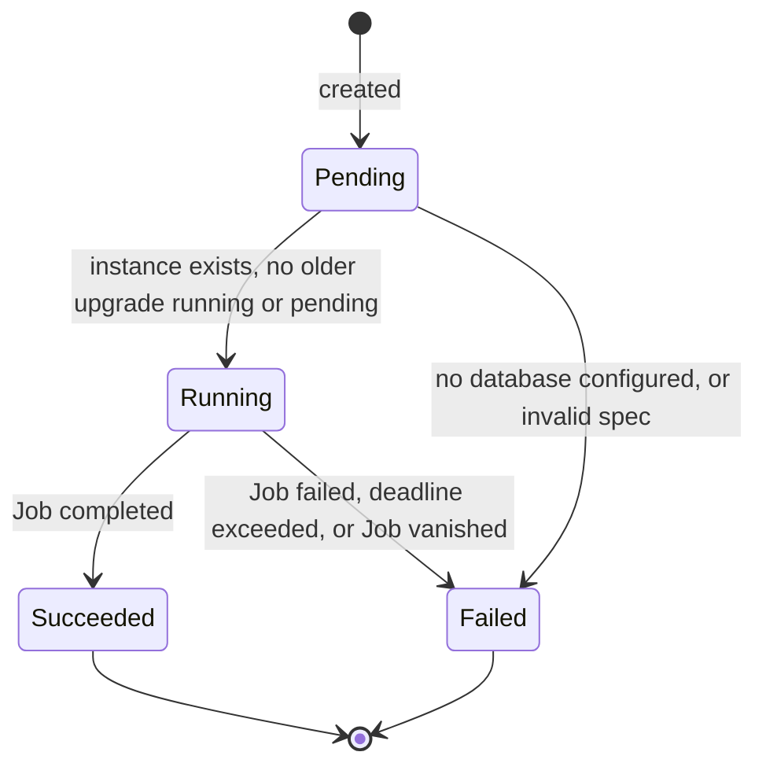
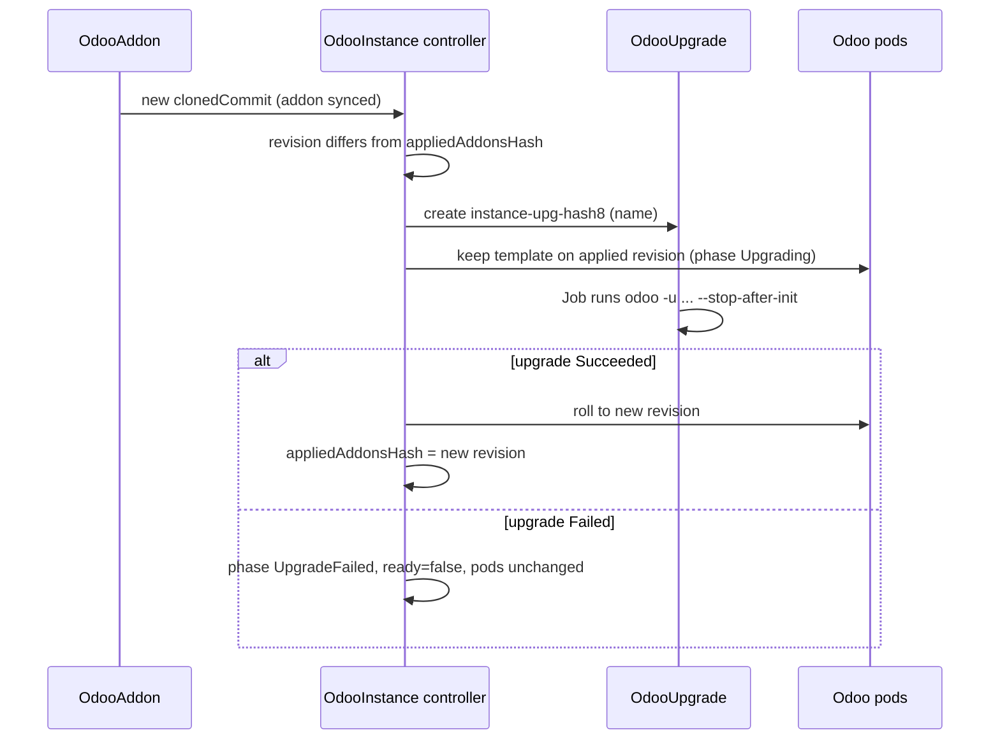

# Module upgrades

Odoo needs `odoo -u <module>` to apply changed module code to the database (data files, views, schema). The operator runs that command in a one-shot Job called an **OdooUpgrade**. You can create one by hand, or let `spec.upgrade` on the OdooInstance create them whenever the synced addon code changes. With `spec.upgrade`, the operator also holds the pods on the old code until the upgrade succeeds.

## Contents

- [OdooUpgrade reference](#odooupgrade-reference)
- [Phases and queueing](#phases-and-queueing)
- [The upgrade Job](#the-upgrade-job)
- [Manual upgrade](#manual-upgrade)
- [Automatic upgrades (spec.upgrade)](#automatic-upgrades-specupgrade)
- [Retrying a failed upgrade](#retrying-a-failed-upgrade)
- [What is not gated](#what-is-not-gated)
- [Limitations](#limitations)

## OdooUpgrade reference

```yaml
apiVersion: odoo.operator.io/v1
kind: OdooUpgrade
metadata:
  name: shop-upgrade-1
  namespace: odoo
spec:
  instanceRef:
    name: shop
  modules: ["geox_theme", "sale_custom"]
  installModules: []        # optional, see below
  database: shop            # optional
  timeoutSeconds: 1800      # optional
```

| Field | Type | Default | Validation | Description |
|---|---|---|---|---|
| `spec.instanceRef.name` | string | required | non-empty | OdooInstance in the same namespace. The upgrade uses its image, config, addons and database. |
| `spec.instanceRef.namespace` | string | empty | empty or the upgrade's namespace | Cross-namespace references are refused. |
| `spec.modules` | list of string | none | max 100 items, each `^[a-zA-Z0-9_]+$` | Passed to `-u`. `["all"]` must be the only entry. |
| `spec.installModules` | list of string | none | max 100 items, each `^[a-zA-Z0-9_]+$` | Passed to `-i`. |
| `spec.database` | string | the instance's `postgres.database` | `^[a-zA-Z0-9_.-]+$` | Database to upgrade. |
| `spec.timeoutSeconds` | int64 | `1800` | 60 to 86400 | Job `activeDeadlineSeconds`. |
| `spec.withDemo` | bool | `false` | none | With `installModules`, demo data is loaded only when `true`. Otherwise the Job passes `--without-demo=True`, which means no demo data on Odoo 16 to 19. |
| `spec.adminUserPasswordSecret` | string | none | non-empty when set | Secret in the same namespace, key `password`. After `installModules` succeeded, the password of the Odoo user `admin` is set through `odoo shell`. Requires `installModules`. |

Rules:

- At least one of `modules` or `installModules` is required.
- The spec is **immutable**. To run another upgrade, create a new OdooUpgrade with a new name.

Status:

| Field | Meaning |
|---|---|
| `status.phase` | `Pending`, `Running`, `Succeeded` or `Failed`. |
| `status.jobName` | Name of the Job, `<name>-run`. |
| `status.message` | Reason for `Pending` (waiting) or `Failed`. For a failed Job it includes `--- last log lines ---` and up to about 2000 bytes of the pod log. |
| `status.startTime`, `status.completionTime` | When the Job started and when it finished. |
| `status.conditions` | `Succeeded` and `Progressing`. See below. |

| Type | Status | Reasons |
|---|---|---|
| `Succeeded` | `True` | `Complete`. |
| `Succeeded` | `False` | `JobFailed`, or `InvalidSpec` (for example no database). |
| `Succeeded` | `Unknown` | `Pending` (queued behind another upgrade), `InstanceNotFound`, `Running`. |
| `Progressing` | `True` | `Running`. |
| `Progressing` | `False` | `Pending`, `Complete`, `JobFailed`, `InvalidSpec`. |

`Succeeded` and `Failed` are final. The controller does not change them again.

## Phases and queueing



`Pending` is also used while waiting:

- for the OdooInstance to exist (message `waiting for OdooInstance`);
- for another upgrade on the same instance to finish (message `waiting for upgrade "<name>" on the same instance to finish`).

Upgrades for one instance run **one at a time**. An upgrade starts only when no sibling is `Running` and no older sibling is `Pending`. Age is the creation timestamp, then the name. Finished upgrades never block.

## The upgrade Job

The operator creates a Job named `<name>-run`, owned by the OdooUpgrade. The command is:

```text
odoo --config /etc/odoo/odoo.conf -d <database> [-u <modules>] [-i <installModules> [--without-demo=True]] --stop-after-init --no-http
```

With `adminUserPasswordSecret` set, the container runs `/bin/sh -c` instead. The script runs the install above, then `odoo shell` with a short Python snippet on stdin that sets the password from the environment variable `ODOO_ADMIN_USER_PASSWORD`. `set -e` makes the Job fail when either step fails. The password is not in the arguments, the script or the log.

| Setting | Value |
|---|---|
| Image | The instance's `image`. |
| Config, addons, data | Same volumes as the Odoo pods. Addons are read-only, the filestore is read-write. |
| Database credentials | `PGPASSWORD` and `DB_PASSWORD` from `postgres.passwordSecret`, `PGSSLMODE=require`. |
| Admin password | Not set, and the HTTP server never starts. With `adminUserPasswordSecret`, only `ODOO_ADMIN_USER_PASSWORD` is set, from that Secret. |
| Security | UID and GID `100`, non-root, read-only root filesystem, all capabilities dropped, no privilege escalation, `RuntimeDefault` seccomp, no service account token. |
| Resources | The instance's `resources`. |
| Retries | `backoffLimit: 0`. A failed run is final. |
| Deadline | `activeDeadlineSeconds` = `timeoutSeconds`. |
| Cleanup | `ttlSecondsAfterFinished: 86400`. The Job and its logs are kept for a day. |
| Node placement | If the addons or the data volume is not `ReadWriteMany`, the Job is pinned to the node of a running Odoo pod (when one exists). |

Nothing stops the running Odoo pods. They keep serving requests against the same database while the Job runs, so schedule upgrades for a quiet period.

Read the Job log while it exists:

```bash
kubectl -n odoo logs job/shop-upgrade-1-run
```

## Manual upgrade

Use a manual upgrade to apply module changes without changing the instance's `spec.upgrade`, for example to test a change or to upgrade a database copy.

```yaml
apiVersion: odoo.operator.io/v1
kind: OdooUpgrade
metadata:
  name: shop-upgrade-1
  namespace: odoo
spec:
  instanceRef:
    name: shop
  modules: ["geox_theme", "sale_custom"]
  timeoutSeconds: 1800
```

```bash
kubectl apply -f shop-upgrade-1.yaml
kubectl -n odoo get odooupgrade shop-upgrade-1 -w
```

A manual upgrade does **not** hold the pods. It only runs `odoo -u` against the database.

To install modules into an existing database, use `installModules`:

```yaml
spec:
  instanceRef:
    name: shop
  installModules: ["base"]
```

The database must already exist, or the database user must be able to create it. For a new instance, prefer `spec.initialize` on the OdooInstance, which also sets the admin password. See [odooinstance.md](odooinstance.md#database-initialisation).

To set the password of the Odoo user `admin` in the same run, add `adminUserPasswordSecret`. It requires `installModules`:

```yaml
spec:
  instanceRef:
    name: shop
  installModules: ["base"]
  adminUserPasswordSecret: shop-init-admin   # Secret, key "password"
```

The install and the password step have not been run against a real Odoo in CI. Check the Job log on your cluster.

## Automatic upgrades (spec.upgrade)

Set `spec.upgrade` on the OdooInstance:

```yaml
spec:
  upgrade:
    modules: ["geox_theme", "sale_custom"]   # or ["all"]
    timeoutSeconds: 1800                      # optional, 60 to 86400
```

The operator compares the revision of the ready addons (the `clonedCommit` of every ready OdooAddon bound to the instance) with `status.appliedAddonsHash`:



Step by step:

1. An addon syncs a new commit, so the addons revision changes.
2. The operator creates the OdooUpgrade `<instance>-upg-<first 8 hex chars of the new revision hash>`. It has the modules and timeout from `spec.upgrade`, and is owned by the instance.
3. While it runs, the instance phase is `Upgrading` and `status.activeUpgrade` names the OdooUpgrade. The pod template keeps the applied revision, so no pods are replaced.
4. On `Succeeded`, the pods roll to the new revision and `status.appliedAddonsHash` advances.
5. On `Failed`, the phase becomes `UpgradeFailed` and `ready` becomes `false`. The pods keep the previous revision. The operator does not retry by itself.

Notes:

- The first reconcile after `spec.upgrade` is set rolls out directly, with no upgrade. A new instance has nothing to upgrade.
- Changing the revision again during an upgrade creates another OdooUpgrade for the newest revision. Upgrades still run one at a time.
- Use `modules: ["all"]` when you do not want to list modules. It is slower on large databases.

## Retrying a failed upgrade

For an automatic upgrade (`UpgradeFailed`), delete the failed OdooUpgrade:

```bash
kubectl -n odoo get odooupgrade
kubectl -n odoo delete odooupgrade shop-upgrade-<hash8>
```

The instance reconciles, sees that the upgrade for the revision is missing, and creates a new one. Fix the cause first (see [operations.md](operations.md#upgrade-failed)), or the new run fails the same way.

For a manual upgrade, create a new OdooUpgrade with a new name. The spec is immutable, so you cannot edit a failed one.

## What is not gated

`spec.upgrade` gates only the rollout caused by an addon revision change. These changes roll the pods immediately, without `odoo -u`:

- `spec.image`, including an Odoo version bump;
- `spec.config` (the `odoo.conf` hash changes);
- the contents of the Secrets referenced by `postgres.passwordSecret` or `adminPasswordSecret`;
- `spec.resources`.

For an Odoo version bump, see the runbook in [production-guide.md](production-guide.md#odoo-version-upgrades).

## Limitations

- **Addon files change before the upgrade finishes.** The addons volume is shared. Once the addon revision is synced, the symlinks already point to the new code while the upgrade runs. The running pods were started on the old code. Odoo may read some files lazily, so it can see new files early.
- **The image is the instance's image.** An OdooUpgrade cannot use a different image. A major Odoo version change needs a copy of the database and a second instance, see [production-guide.md](production-guide.md#odoo-version-upgrades).
- **No database backup.** The operator does not back up the database before it changes it. Take a backup first.
- **Deadline.** A run longer than `timeoutSeconds` is killed and marked `Failed`. Raise the timeout for large `-u all` runs.
- **Node pinning depends on running pods.** With `ReadWriteOnce` volumes, the Job is pinned to the node of a running Odoo pod. If no pod is running, the Job is not pinned and may not be able to attach the volume.
- **One instance at a time.** Upgrades for one instance are serialised. A stuck upgrade blocks the next one.

## See also

- [odooinstance.md](odooinstance.md): `spec.upgrade` and the `status` fields.
- [odooaddon.md](odooaddon.md): how addon revisions are synced.
- [operations.md](operations.md): runbooks for failed and stuck upgrades.
